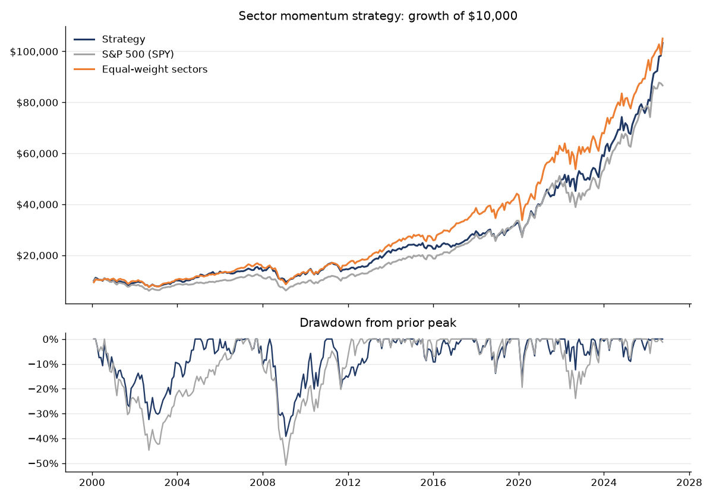

# Sector Momentum Rotation Strategy

A rules-based strategy that holds the three strongest S&P 500 sectors each month, backtested from 2000 to 2026 and tracked live with an automated monthly signal.

**Current picks:** see [latest_signal.md](results/latest_signal.md) · **Live track record:** [live_log.csv](results/live_log.csv)

## The rules

At each month-end close:

1. Measure the 12-month total return of each of the 9 Select Sector SPDR ETFs (XLB, XLE, XLF, XLI, XLK, XLP, XLU, XLV, XLY).
2. Rank them from strongest to weakest.
3. Hold the top 3, one-third each, for the next month.

The settings (12-month lookback, top 3) were chosen from published research on industry momentum (Moskowitz & Grinblatt, 1999) before running the test, not tuned afterward. Real Estate (XLRE) and Communication Services (XLC) are excluded because they launched in 2015 and 2018; leaving them out keeps a 27-year history.

## Backtest results (Feb 2000 – Sep 2026)

| | Strategy | S&P 500 (SPY) | Equal-weight sectors |
| --- | --- | --- | --- |
| Annual return (CAGR) | 8.9% | 8.5% | 9.0% |
| Volatility | 14.7% | 15.1% | 14.7% |
| Sharpe ratio | 0.52 | 0.48 | 0.53 |
| Max drawdown | -39.2% | -50.8% | -49.1% |
| $10,000 grows to | $98,271 | $87,422 | $98,800 |

The strategy matched the market's return while cutting the worst drawdown from 51% to 39%. It held up best in 2002, 2008 and 2022, and lagged in fast rebounds such as 2009 and 2023. Results are net of a 10 bps trading cost, use dividend-adjusted prices, and avoid look-ahead bias: picks made at one month-end only earn the following month's return.

## How the automation works

A GitHub Actions workflow ([.github/workflows/monthly.yml](.github/workflows/monthly.yml)) runs on the 1st of every month:

1. Downloads the latest month-end prices from Yahoo Finance.
2. Ranks the sectors and writes the new picks to `results/latest_signal.md`.
3. Records last month's realized return vs. SPY in `results/live_log.csv`.
4. Re-runs the backtest and updates the chart.
5. Opens an issue with the picks, which triggers an email notification.

## Files

| File | What it is |
| --- | --- |
| `src/momentum.py` | Monthly signal and live tracking |
| `src/backtest.py` | Full backtest, results table and chart |
| `excel/Sector_Momentum_Backtest.xlsx` | The original Excel model, with adjustable inputs and a robustness check across 20 settings |
| `results/live_log.csv` | Every live signal and its realized return |

Run it yourself: `pip install -r requirements.txt`, then `python src/momentum.py` or `python src/backtest.py`.

## Limitations

- Late to sharp market reversals, since it holds last year's winners.
- Concentrated in 3 sectors at a time.
- About 270% annual turnover, which matters for costs and taxes.
- One historical period and nine assets is a limited sample.

Built by Deacon Junk, finance student at Dallas Baptist University. Educational project, not investment advice.
