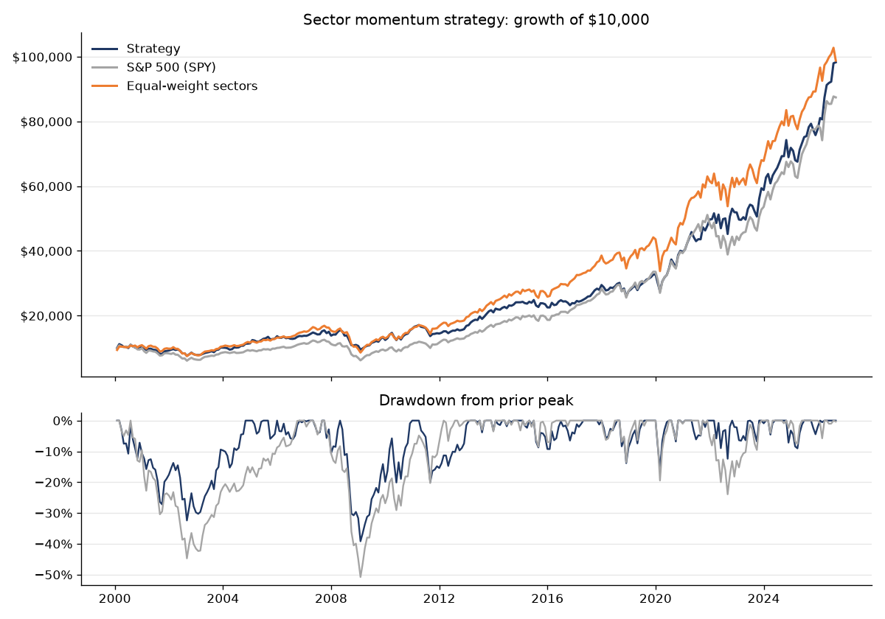

# Sector Momentum Rotation Strategy

A rules-based strategy that holds the three strongest S&P 500 sectors each month, backtested from 2000 to 2026 and tracked live with an automated monthly signal.

**Current picks:** see [latest_signal.md](latest_signal.md) · **Live track record:** [live_log.csv](live_log.csv)

## The rules

At each month-end close:

1. Measure the 12-month total return of each of the 9 Select Sector SPDR ETFs (XLB, XLE, XLF, XLI, XLK, XLP, XLU, XLV, XLY).
2. Rank them from strongest to weakest.
3. Hold the top 3, one-third each, for the next month.

The settings (12-month lookback, top 3) were chosen from published research on industry momentum (Moskowitz & Grinblatt, 1999) before running the test, not tuned afterward. Real Estate (XLRE) and Communication Services (XLC) are excluded because they launched in 2015 and 2018; leaving them out keeps a 27-year history.

## Backtest results (Feb 2000 – Sep 2026)

| | Strategy | S&P 500 (SPY) | Equal-weight sectors |
| --- | --- | --- | --- |
| Annual return (CAGR) | 8.9% | 8.5% | 9.0% |
| Volatility | 14.7% | 15.1% | 14.7% |
| Sharpe ratio | 0.52 | 0.48 | 0.53 |
| Max drawdown | -39.2% | -50.8% | -49.1% |
| $10,000 grows to | $98,271 | $87,422 | $98,800 |

The strategy matched the market's return while cutting the worst drawdown from 51% to 39%. It held up best in 2002, 2008 and 2022, and lagged in fast rebounds such as 2009 and 2023. Results are net of a 10 bps trading cost, use dividend-adjusted prices, and avoid look-ahead bias: picks made at one month-end only earn the following month's return.

## Strategy 2: Individual stock momentum

A more aggressive version that picks individual S&P 500 stocks instead of sectors.

**Current picks:** [stock_signal.md](stock_signal.md) · **Backtest:** [stock_backtest_results.md](stock_backtest_results.md) · **Live track record:** [stock_live_log.csv](stock_live_log.csv)

At each month-end close:

1. Measure every S&P 500 stock's **12-1 momentum**: the return from 12 months ago to 1 month ago. The latest month is skipped because last month's winners tend to give some back the following month (short-term reversal).
2. Hold the top 20, 5% each, for the next month.
3. **Trend filter:** if SPY closes below its 10-month moving average, hold T-bills instead. Momentum's worst losses come in sharp rebounds after bear markets (2009 is the classic case), and this rule keeps the strategy out of the market during most of those bear markets.

Settings come from published research rather than tuning: 12-1 momentum from Jegadeesh & Titman (1993), the 10-month trend rule from Faber (2007). The backtest includes a robustness table showing results for 10, 20, 30 and 50 stocks, with and without the filter.

**How the backtest handles survivorship bias.** Each month it picks only from stocks that were actually in the S&P 500 at that time, using point-in-time membership data from [fja05680/sp500](https://github.com/fja05680/sp500). Testing on today's list would only include companies that survived and grew, which inflates results. One gap remains: Yahoo Finance doesn't carry prices for many delisted companies, so those can't be picked. The results file reports how much of the index had price data. A stock that stops trading while held is treated as sold flat at its last price.

## How the automation works

A GitHub Actions workflow ([.github/workflows/monthly.yml](.github/workflows/monthly.yml)) runs on the 1st of every month:

1. Downloads the latest month-end prices from Yahoo Finance.
2. Ranks the sectors and writes the new picks to `latest_signal.md`.
3. Records last month's realized return vs. SPY in `live_log.csv`.
4. Re-runs the backtest and updates the chart.
5. Opens an issue with the picks, which triggers an email notification.
6. Does the same for the stock strategy (`stock_momentum.py`, `stock_backtest.py`).

## Files

| File | What it is |
| --- | --- |
| `momentum.py` | Monthly signal and live tracking |
| `backtest.py` | Full backtest, results table and chart |
| `Sector_Momentum_Backtest.xlsx` | The original Excel model, with adjustable inputs and a robustness check across 20 settings |
| `live_log.csv` | Every live signal and its realized return |
| `stock_momentum.py` | Stock strategy: monthly signal and live tracking |
| `stock_backtest.py` | Stock strategy: backtest, robustness check and chart |
| `stock_live_log.csv` | Every live stock signal and its realized return |

Run it yourself: `pip install -r requirements.txt`, then `python momentum.py` or `python backtest.py`.

## Limitations

- Late to sharp market reversals, since it holds last year's winners.
- Concentrated in 3 sectors at a time.
- About 270% annual turnover, which matters for costs and taxes.
- One historical period and nine assets is a limited sample.
- Stock strategy: about 20 positions with high turnover, so trading costs and taxes matter more; delisted stocks missing from Yahoo leave some survivorship bias.

Built by Deacon Junk, finance student at Dallas Baptist University. Educational project, not investment advice.
